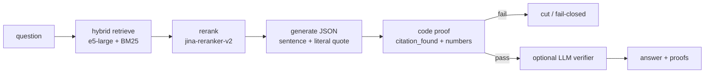

# rag-assertivo

**Fail-closed RAG for PT-BR.** Hybrid retrieve (dense + BM25) → cross-encoder rerank → answer with a **literal citation per sentence**, checked by code. Unverified text never leaves.

Senior-AI-engineer proof in ten seconds: the reranker is optional, the **proof is not**. A tempting “split pools” change was measured, **rejected**, and documented.



LangGraph runs that chain (`rag/graph.py`). Tracing: [docs/TRACING.md](docs/TRACING.md) (Langfuse or LangSmith, both optional).

---

## Why this is not a toy RAG

| layer | what ships | what does **not** ship |
|---|---|---|
| retrieve | `intfloat/multilingual-e5-large` + `Qdrant/bm25` in one Qdrant collection (int8 RAM, original on disk) | a single dense ANN and a prayer |
| rerank | `jinaai/jina-reranker-v2-base-multilingual` on a wide candidate pool | trusting HNSW order |
| synthetic | ementa/resumo/qa is **not citable** (`citavel=false`) | quoting an LLM summary as if it were the statute |
| answer | JSON sentences + literal `citacao`; `rag.proof` cuts `citacao_ausente` / `numero_sem_prova` | “the model usually cites well” |
| eval | golden + traps + funnel (where the right chunk dies) + release gate with McNemar | a vibes demo notebook |
| corpus | official Brazilian law (Planalto), vendored, reproducible ingest | paid courses, member-area scrapes, private transcripts |

Phrase proof is the product. Measured on a private production corpus (anonymized below): a relevance-score cutoff added **zero** extra trap catches on the test split — the citation contract already refused what the cutoff would have refused. So `MIN_RELEVANCE` stayed off.

---

## Eval: baseline vs rerank vs pools

Numbers below are from a **private** PT-BR production corpus (calibration split, evidence threshold L = 0.6, hybrid e5-large + BM25 + Jina v2). They are **not** measurements of the public golden set in `eval/golden.jsonl`. Collection names, hosts, and questions are withheld; the funnel code in `eval/` is the same.

Each question dies in at most one step. `viva` = the right chunk reached top-k.

### Deaths by step (both paths summed)

| corpus | variant | 1 chunk | 2 miss | 3 rerank drop | 4 MCP k-cut | viva | dominant |
|---|---|---|---|---|---|---|---|
| A (large, mixed primary + synthetic) | hybrid + rerank (**shipped**) | 53 | **90** | 2 | 14 | 121 | **2 first search** |
| A | + split pools + synthetic penalty 0.5 | 53 | 88 | 1 | **6** | 132 | 2 (almost unchanged) |
| B (smaller, multi-facet questions) | hybrid + rerank | **20** | 3 | 1 | 4 | 18 | **1 chunking** |
| B | + split pools + penalty 0.5 | 20 | 2 | 0 | 3 | 21 | 1 |

### Latency (interleaved A/B, same pass, HNSW)

| corpus | path | off p50 / p95 (s) | pools on p50 / p95 | ratio |
|---|---|---|---|---|
| B | CLI k=15 | 4.93 / 5.83 | 6.01 / 6.90 | 1.22 / 1.19 |
| B | MCP k=6 | 3.06 / 3.43 | 3.47 / 3.88 | 1.14 / 1.13 |
| A | CLI k=15 | 5.33 / 6.56 | 6.16 / 7.92 | 1.16 / 1.21 |
| A | MCP k=6 | 3.13 / 4.07 | 3.51 / 4.93 | 1.12 / 1.21 |

**Decision: pools not merged.** CLI gain was +2 questions (need ≥ 3, McNemar). Latency +12–22%. The hypothesis (“synthetic crowding causes step-2 deaths”) failed: 41 of 45 step-2 CLI misses were `nenhum` — **neither** dense-only nor sparse-only retrieved the evidence. Split pools mostly helped step 4 (MCP `k=6` cutting a CLI hit). That is a k-policy problem, not a fusion problem.

Rerank itself is cheap in failure terms: step 3 is 1–2 deaths. Turning rerank **off** is not a baseline this eval uses in production; the shipped system is hybrid **with** Jina. The public harness (`python -m eval.run_funnel --backend fake`) lets you A/B `RAG_RERANK=0` against `1` on the legislative golden set.

Release gate (answer rate / facet coverage / fail-closed) on the same private calibration:

| corpus | variant | answer rate | facet-in-answer | p50 / p95 (s) |
|---|---|---|---|---|
| B | base | 1.00 | 0.672 | 32.9 / 83.8 |
| B | pools | 1.00 | 0.688 | 30.2 / 70.0 |
| A | base | 1.00 | n/a | 28.3 / 46.5 |
| A | pools | 1.00 | n/a | 27.4 / 40.7 |

Reproduce the **public** gate (lexical backend, no keys):

```bash
pip install -r requirements-dev.txt
python -m eval.run_gate run --tag demo --backend fake
python -m eval.run_funnel --backend fake --tag demo
pytest -q
```

---

## `docker compose up`

```bash
cp .env.example .env
docker compose up -d qdrant rag
docker compose run --rm ingest    # first run downloads e5-large + BM25 (~minutes)
```

- Qdrant: <http://localhost:6333>
- MCP HTTP: <http://localhost:8000/mcp>
- Health: `curl -fsS http://localhost:8000/healthz`

Ingest reads **only** `corpus/texts/*.md` (official Planalto excerpts). No scrapers.

Without Docker (stdio MCP, after a local ingest):

```bash
python -m ingest.ingest          # needs Qdrant + models
python -m rag.mcp_server         # MCP_TRANSPORT=stdio
```

The extractive generator is the default (`RAG_GEN_MODEL=extractive`). Set `OPENAI_API_KEY` / `ANTHROPIC_API_KEY` and `RAG_GEN_MODEL=gpt-4o-mini` (or `claude-haiku-4-5`) for a real model. Tests never need those keys.

---

## Talk to the MCP

Cursor / Claude Desktop — **stdio** (no Docker):

```json
{
  "mcpServers": {
    "rag-assertivo": {
      "command": "python",
      "args": ["-m", "rag.mcp_server"],
      "env": {
        "QDRANT_URL": "http://localhost:6333",
        "COLLECTION_NAME": "publico_br"
      }
    }
  }
}
```

**HTTP** (after `docker compose up`):

```json
{
  "mcpServers": {
    "rag-assertivo": {
      "url": "http://localhost:8000/mcp"
    }
  }
}
```

If `MCP_AUTH_TOKEN` is set (≥16 chars), send `Authorization: Bearer <token>`.

Tools:

| tool | does |
|---|---|
| `search` | hybrid + rerank. Each hit has `citavel`. |
| `answer` | LangGraph retrieve → rerank → generate → code-check. `status`: `ok` \| `nao_encontrado` \| `falha_verificacao`. |
| `health` | collection up? point count? |
| `list_sources` | the public Planalto documents |

Contract: cite numbers and claims **only** from `citavel=true`. Ementas are a map, not a source.

CLI: `python -m rag search "o que é dado pessoal"` · `python -m rag answer "prazo de vício no CDC"`

---

## Layout

```
rag/            retrieve, proof, answer, LangGraph, MCP
ingest/         chunk + secret scan + upsert (public files only)
corpus/texts/   CF/88, LGPD, CDC, LAI, Marco Civil (excerpts)
eval/           golden, traps, judge, run_gate, funnel
tests/          mocks; `pytest -q` on a clean checkout
```

Sanitization checklist: [docs/LEFT_OUT.md](docs/LEFT_OUT.md). Tracing: [docs/TRACING.md](docs/TRACING.md). Eval details: [eval/README.md](eval/README.md).

---

## Resumo PT-BR

RAG que **não inventa**. Busca híbrida (e5-large + BM25 no Qdrant), rerank Jina v2, resposta com citação literal por frase conferida por código (`rag.proof` + guarda de números). Texto sem prova não sai. Eval com golden, armadilhas, juiz, portão de release e funil (em que degrau o trecho certo morre). Corpus só de legislação pública brasileira. Pools separados foram medidos em produção e **reprovados** (ganho insuficiente, latência +12–22%). Orquestração LangGraph; tracing Langfuse/LangSmith opcional. `docker compose up` + MCP em stdio ou HTTP.

---

MIT. Public legislative excerpts: official texts, vendored from planalto.gov.br for reproducible ingest.
